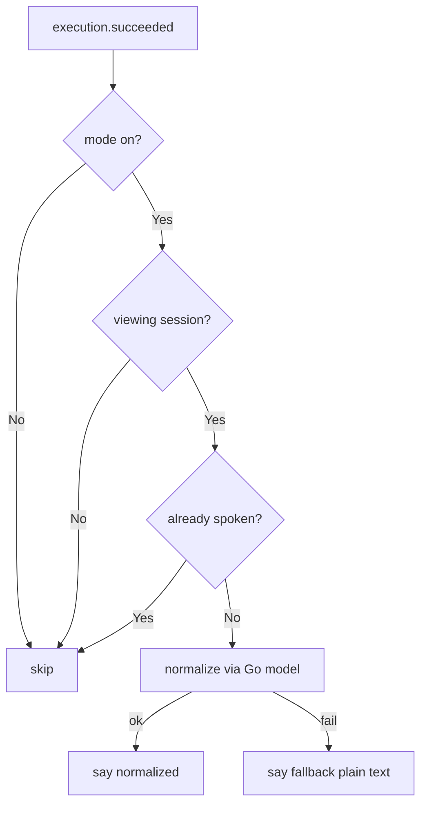
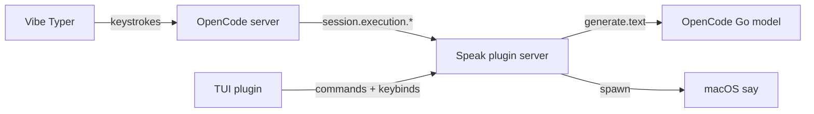

# PRD: OpenCode Speak (TTS)

## Context

User drives OpenCode via Vibe Typer for input and wants assistant replies read aloud. Prior art `renjfk/opencode-voice` (MIT) proves the pipeline: collect turn → LLM-normalize markdown to speakable text → local synthesis. This plugin adapts only TTS + normalization; STT is out of scope.

## Goals

- Read assistant replies aloud via free local synthesis, toggleable.
- Normalize markdown to speakable text via the user's existing OpenCode Go subscription (no extra keys/servers).
- Work in TUI; no STT, no cloud TTS keys.

## Non-goals

- Speech-to-text, whisper, microphone selection, dictation (Vibe Typer covers it).
- Paid TTS (ElevenLabs, OpenAI TTS), cloud TTS keys.
- Custom LLM endpoint config (`endpoint`/`apiKeyEnv`); local Ollama servers.

## Features

### Auto-speak turn

#### Requirement

When a session turn completes AND speaking is enabled AND the user is viewing that session in this window, the plugin SHALL normalize the turn's assistant text via the configured Go model and speak it with the configured engine.

#### Business Rules

- Default state SHALL be off on first install.
- Code-heavy turns SHALL be summarized, not read verbatim (via SYSTEM_AUTO prompt).
- The same messageID SHALL NOT be spoken twice per window.
- Normalization failures SHALL fall back to truncated plain-text speech, never silence.
- New speech SHALL preempt old speech in the same window.

#### Business Rules

- Default state SHALL be off on first install.
- Code-heavy turns SHALL be summarized, not read verbatim (via SYSTEM_AUTO prompt).
- The same messageID SHALL NOT be spoken twice.
- Normalization failures SHALL fall back to truncated plain-text speech, never silence.

#### Acceptance Criteria

- AC-001: WHEN a turn succeeds AND mode is on AND its session is viewed, THEN normalized speech starts within 5s.
- AC-002: WHEN mode is off, THEN no speech starts on turn completion.
- AC-003: WHEN the viewed session differs from the completed session, THEN no speech starts.
- AC-004: WHEN normalization returns empty/throws, THEN fallback plain text (max 800 chars) is spoken AND no error blocks the session.
- AC-005: WHEN the same turn completes twice (retry/replay), THEN it is spoken at most once.

#### Technical Definition

- Trigger SHALL live in the TUI part (`context.data.on` `session.execution.succeeded` + `interrupted`); `started` marks busy, `failed` clears it. Each window speaks ONLY the session it is showing, so background sessions stay silent with no cross-instance coordination.
- Turn text SHALL be assistant messages since last user message, `type: "text"` parts only, read from the TUI message cache.
- Normalization SHALL call server RPC `normalize` (`ctx.experimental.generate.text`, `opencode-go/*`, default `deepseek-v4.1-flash`).
- Synthesis SHALL be local per window: Edge TTS (MP3 via `edge-tts` + `afplay`) by default, `say` when configured or as fallback; concurrent speech SHALL kill the prior process first.

#### Flow



### Manual speak, stop, toggle

#### Requirement

User can toggle auto-speak, manually read the last response in detail, and stop playback via commands and keybinds.

#### Acceptance Criteria

- AC-101: WHEN `/speak-on` or `leader+v` runs, THEN mode persists across restarts AND toast confirms state.
- AC-102: WHEN `/tts-speak` or `leader+s` runs with a prior assistant message, THEN full prose is read via SYSTEM_MANUAL normalization.
- AC-103: WHEN `/tts-speak` runs with no assistant message, THEN a warning toast shows AND nothing is spoken.
- AC-104: WHEN `/speak-stop` or `escape` runs during playback, THEN `say` is killed within 1s.
- AC-105: WHEN `escape` runs with no playback, THEN it falls through (does NOT swallow session-interrupt).

#### Technical Definition

- Server commands `speak-on`/`speak-off` flip the shared flag; TUI slash `speak-mode` toggles, `tts-speak` reads manually, `speak-stop` stops.
- State key `enabled: boolean` SHALL live in server `ctx.storage` (shared source of truth).
- TUI SHALL register a `context.keymap.layer`: `leader+v` toggle, `leader+s` manual, `escape` stop-with-fallthrough (`return false`, per `renjfk` pattern).

## System Architecture



## Data Model

```text
server ctx.storage
- enabled: boolean (default false; plugin option `enabled: true` overrides the first-run default)

plugin options
- engine: "edge" | "say" (default "edge")
- voice: engine voice id (default "en-US-AriaNeural" / "Samantha")
- sayVoice: fallback voice (default "Samantha")
- normalizeProvider / normalizeModel (default "opencode-go" / "deepseek-v4.1-flash")
- maxChars, debugLog
```

## Technical Constraints

- Server part owns flag + normalization only; TUI owns triggers, visibility gate, and audio.
- Normalization MUST NOT use custom fetch/keys; MUST use `ctx.experimental.generate.text` with `opencode-go/*`.
- Synthesis default MUST be Edge TTS with `say` fallback; Piper/Kokoro MAY be added later behind `options.engine` without changing normalization.
- `SYSTEM_AUTO`/`SYSTEM_MANUAL` prompts adapted from `renjfk/opencode-voice` (MIT) with attribution comment.
- DeepSeek models REQUIRE Global region opt-in; README SHALL state this.

## Definition of Done

- All acceptance criteria pass.
- Toggle, manual read, and stop verified in TUI with `say` audible.
- No STT code, no secrets, no extra endpoint config shipped.
- No non-goal implemented.
